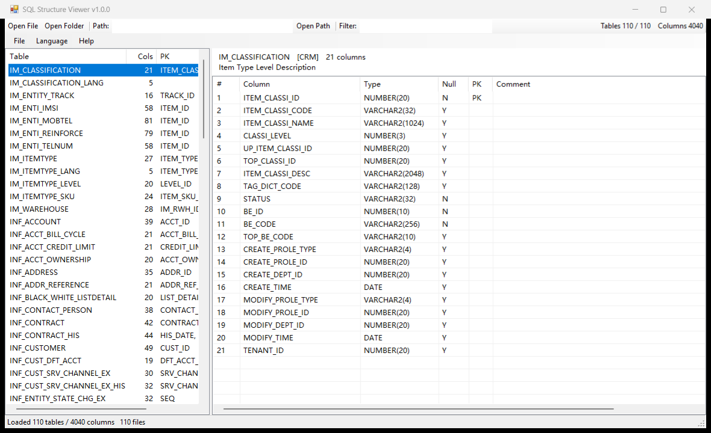

# SQL Structure Viewer

[中文](README.zh-CN.md) · **English**

> Drop a whole folder in. Read the column names, types, primary keys and comments of 110 tables at a glance.

A **tiny** Windows desktop tool that opens SQL DDL (`CREATE TABLE`) files and shows table structures
in a grid.

A single **~40 KB** EXE with zero dependencies — no .NET SDK, no Python, no Node, no installer.



> The UI is bilingual. The screenshot above is the English UI; the Chinese one is at
> [docs/screenshot.zh-CN.png](docs/screenshot.zh-CN.png). This document is a full English
> translation of [README.zh-CN.md](README.zh-CN.md).

---

## Why use it

| | |
|---|---|
| **Tiny** | One 40 KB exe. Copy it anywhere and run it. No registry writes, no network calls |
| **No install** | Uses only the .NET Framework 4.x that ships with Windows 10/11 |
| **Batch at once** | Drop in a folder: table list on the left (with filtering), column grid on the right |
| **Paste a path** | Paste into the toolbar "Path" box and hit Enter; the folder dialog has an address bar too |
| **Convenient** | Drag & drop, multi-select, `Ctrl+C` copies as TSV straight into Excel |
| **Bilingual** | English / 中文, switchable from the **Language** menu; follows the Windows UI language on first run |
| **Handles messy DDL** | Comment attribution, composite primary keys, `COMMENT ON COLUMN`, quoted identifiers, UTF-8/GBK |

---

## Quick start

### Option 1 — Download the EXE

1. Download `SqlStructViewer.exe` from the repository root (or the Releases page)
2. Double-click it
3. Drag a `.sql` file **or an entire folder** onto the window

> On first run Windows SmartScreen may warn about an unsigned program — click "More info" → "Run anyway".

### Option 2 — Build from source

All you need is the C# compiler bundled with Windows (.NET Framework 4.x):

```cmd
build.cmd
```

Or manually:

```cmd
"%WINDIR%\Microsoft.NET\Framework64\v4.0.30319\csc.exe" /target:winexe /optimize+ /out:SqlStructViewer.exe SqlStructViewer.cs
```

The build produces exactly one exe — no intermediate files, no dependency copying.

---

## Interface

```
┌ File  Help ─────────────────────────────────────────────────────────┐
│ [Open File] [Open Folder]  Path:[__________________] [Open Path]     │
│                            Filter:[________]   Tables 110/110 Cols 4040│
├────────────────────┬───────────────────────────────────────────────┤
│ Table     Cols PK Src│ INF_SUBSCRIBER   [CRM]   73 columns           │
│ IM_CLASSIFICATION … │ Subscriber basic information.                  │
│ INF_ACCOUNT      … │ #  Column    Type        Null PK  Comment      │
│ INF_SUBSCRIBER  73 … │ 1 SUBS_ID   NUMBER(22)   N    PK  Subscriber ID│
│ …                  │ 2 SUBS_NAME VARCHAR2(256) Y                    │
├────────────────────┴───────────────────────────────────────────────┤
│ Loaded 110 tables / 4040 columns   <current path>                   │
└────────────────────────────────────────────────────────────────────┘
```

- **Left**: table name, column count, primary key, source (read from the DDL header comment)
- **Right**: ordinal, column name, type, nullable (Y/N), PK, comment (read from the `--` comment lines above the column)
- **Top**: path box + filter box; the toolbar on the right shows live `Tables N/N  Columns M`

---

## Language

The UI ships in **English and Chinese** and can be switched at runtime — no restart.

- **First run**: the language follows your Windows display language (Chinese Windows → Chinese,
  anything else → English).
- **Switching**: menu **Language → 中文 / English**. The whole window retitles immediately and the
  choice is remembered.
- **Remembered in**: `%APPDATA%\SqlStructViewer\lang.txt` (a single line, `zh` or `en`). Delete the
  file to go back to auto-detection.
- **Override per launch**: `SqlStructViewer.exe --lang en <path>` / `--lang zh`.

The language menu items are always labelled in their own language (`中文` / `English`), so you can
find your way back even if you land in the wrong one.

---

## Five ways to open files

| Method | How |
|---|---|
| **Paste a path** (recommended) | Paste into the toolbar "Path" box with `Ctrl+V`, press **Enter**. Multiple paths at once are fine (`;` or newline separated); quote paths that contain spaces |
| **Drag & drop** | Drop `.sql` files or a folder straight onto the window |
| **Open File** | `Ctrl+O`, multi-select supported |
| **Open Folder** | `Ctrl+Shift+D`; the modern dialog has an address bar where you can paste a path, and supports multi-select |
| **Command line** | `SqlStructViewer.exe "D:\path\to\ddl"` — pass several files or folders; can be associated with the `.sql` file type |

---

## Keyboard shortcuts

| Shortcut | Action |
|---|---|
| `Ctrl+O` | Open file |
| `Ctrl+Shift+D` | Open folder |
| `Ctrl+Shift+O` | Focus the "Path" box |
| `Enter` (in the path box) | Open that path |
| `Ctrl+C` (column grid) | Copy selected rows as TSV |
| `Ctrl+A` (column grid) | Select all |
| `Ctrl+C` / `Ctrl+A` (table list) | Copy selected rows / select all |

> `Ctrl+A` then `Ctrl+C` in the column grid gives you a header row plus data as TSV — paste it
> straight into Excel or a Markdown table.

---

## Supported DDL syntax

Built for Oracle-style DDL (types `VARCHAR2` / `NUMBER(p,s)` / `DATE` / `TIMESTAMP` / `CLOB` are
preserved verbatim), while tolerating common dialect variants:

- **Multiple tables** in a single file (split on each `CREATE TABLE`)
- `CREATE TABLE` / `CREATE TABLE IF NOT EXISTS` / `TEMPORARY TABLE`
- Quoted identifiers: `"double quotes"`, `` `backticks` ``, `[brackets]`, plus `schema.table` prefixes
- **Composite primary keys**: `CONSTRAINT PK_X PRIMARY KEY (A, B, C)` and inline `PRIMARY KEY`
- **Nullability**: `NOT NULL`
- `--` comment lines directly above a column are **attributed to that column** (multi-line comments are joined)
- `COMMENT ON COLUMN tbl.col IS '...'` statements
- Other column modifiers: `DEFAULT` / `CHECK` / `REFERENCES` / `COLLATE` / `GENERATED` / `AUTO_INCREMENT` / `IDENTITY`
- Table-level constraint rows (`UNIQUE` / `FOREIGN` / `CHECK` / `KEY` / `INDEX`) are skipped
- File encodings: UTF-8 (with or without BOM), falling back to GBK
- Non-DDL statements (`INSERT`, `SELECT`, …) are ignored

---

## Command line

```cmd
:: Open files or folders (multiple allowed)
SqlStructViewer.exe D:\ddl
SqlStructViewer.exe a.sql b.sql D:\more-ddl

:: Force the UI language for this run (zh | en)
SqlStructViewer.exe --lang en D:\ddl

:: Diagnostic mode: write the parse result to a text file, for scripting / CI checks
SqlStructViewer.exe --dump in.sql out.txt
```

Sample `--dump` output:

```
TABLE INF_SUBSCRIBER  [CRM]  cols=73  pk=SUBS_ID
  desc: Subscriber basic information.
      1  SUBS_ID                   NUMBER(22)      NOT NULL PK 
      2  SUBS_NAME                 VARCHAR2(256)               
```

---

## FAQ

**The left pane is empty after opening a file.**
The file contains no recognisable `CREATE TABLE`. Run it through `--dump` to see what was parsed.
Unsupported constructs (e.g. `CREATE TABLE ... AS SELECT`) won't appear.

**It says a file failed to load.**
The file is locked or the encoding is unusual. The tool tries UTF-8 first, then GBK, and skips the
file if both fail (the status bar reports the failure count).

**Can I change column order or add columns to the grid?**
Yes — edit the `lstColumns.Columns.Add(...)` calls in `BuildBody()` in `SqlStructViewer.cs` and
re-run `build.cmd`.

**Why not Electron / Python?**
Then it wouldn't be 40 KB. The whole point is "one exe, double-click, done."

**Will antivirus flag it?**
Unsigned small .NET binaries are occasionally flagged by heuristics. The source is right here —
run `build.cmd` yourself and compare.

---

## Project structure

```
.
├── SqlStructViewer.cs        All source code (single file, C# 5, WinForms)
├── SqlStructViewer.exe       Build output (ready to use)
├── build.cmd                 Rebuild
├── README.md                 This file (English, repo default)
├── README.zh-CN.md           Chinese documentation
├── CHANGELOG.md
├── LICENSE
└── docs/
    ├── USAGE.md              Detailed usage guide (Chinese)
    ├── USAGE.en.md           Detailed usage guide (English)
    ├── screenshot.png        English UI
    └── screenshot.zh-CN.png  Chinese UI
```

The single source file is ~60 KB, in four parts:

| Part | Responsibility |
|---|---|
| `SqlParser` | DDL parsing: statement splitting, column definitions, primary keys, comment attribution |
| `FolderPicker` | `IFileOpenDialog` + `FOS_PICKFOLDERS` COM interop (modern folder picker) |
| `MainForm` / `Program` | WinForms UI, language switching and entry point |
| `S` | The English/Chinese string table (all UI text lives here) |

---

## Known limitations

- Read-only: it never modifies files or generates SQL
- No semantic validation: no database connection, no type or foreign-key checking
- Very large files (>100 MB or >50k tables) are read into memory at once; no streaming
- `CREATE VIEW` / `CREATE INDEX` are not parsed (silently ignored)
- The UI ships in English and Chinese only

---

## Development

Rebuild after changes:

```cmd
build.cmd
```

Regression check (point it at a directory of DDL files):

```cmd
for %f in (ddl\*.sql) do SqlStructViewer.exe --dump "%f" "out\%~nf.txt"
```

This project was validated against the Ooredoo Maldives BSS DWH data dictionary:
**110 tables / 4040 columns**. The parse results were compared table by table against the source
Excel specification — column counts and primary-key sets matched **110/110**.

---

## License

[MIT](LICENSE)

---

**Detailed usage guide:** [docs/USAGE.en.md](docs/USAGE.en.md) ｜ Chinese: [docs/USAGE.md](docs/USAGE.md)

[中文](README.zh-CN.md) · **English**
