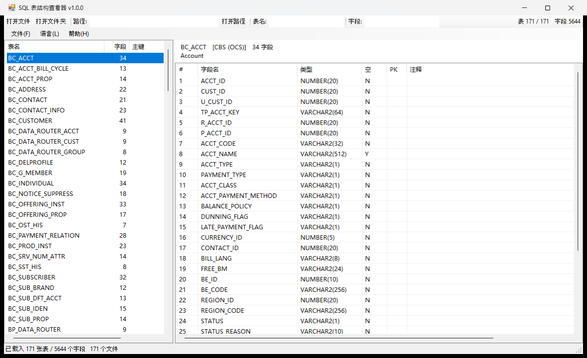

# SQL 表结构查看器 (SQL Structure Viewer)

**中文** · [English](README.md)

> 把一整个文件夹拖进去，110 张表的字段名、类型、主键、注释一屏看完。

一个**极小**的 Windows 桌面工具：打开 SQL DDL（`CREATE TABLE`）文件，用表格展示表结构。

单个 EXE **约 40 KB**，零依赖 —— 不需要 .NET SDK、不需要 Python、不需要 Node、不需要安装。



> 界面中英双语。上图是中文界面，英文界面见 [docs/screenshot.png](docs/screenshot.png)。

---

## 为什么用它

| | |
|---|---|
| **极小** | 一个 40 KB 的 exe，拷到哪都能跑，不写注册表、不发网络请求 |
| **零安装** | 只用 Windows 10/11 自带的 .NET Framework 4.x |
| **一次看一批** | 拖入整个文件夹，左侧表清单（支持过滤）+ 右侧字段网格 |
| **粘贴路径** | 工具栏「路径」框直接 Ctrl+V，回车即开；文件夹对话框也带地址栏 |
| **顺手** | 拖放、多选、Ctrl+C 复制成 TSV 直接贴进 Excel |
| **中英双语** | 界面支持 中文 / English，菜单「语言」即时切换；首次运行跟随 Windows 显示语言 |
| **字段搜索** | 输入字段名的一部分（`acct id`、`DATE`、`subs_id`），一次性搜遍全部已载入的表；空格/下划线/连字符/点号一律忽略，`acct id` 就能搜到 `ACCT_ID` |
| **看得懂乱 DDL** | 注释归属、复合主键、`COMMENT ON COLUMN`、引号标识符、UTF-8/GBK 都能处理 |

---

## 快速开始

### 方式一：直接下载 EXE

1. 从仓库根目录（或 Releases 页面）下载 `SqlStructViewer.exe`
2. 双击运行
3. 把 `.sql` 文件**或整个文件夹**拖进窗口

> 首次运行若出现 Windows SmartScreen 提示（未签名程序都会），点「更多信息」→「仍要运行」。

### 方式二：从源码编译

只需要 Windows 自带的 C# 编译器（.NET Framework 4.x 内置）：

```cmd
build.cmd
```

或者手动执行：

```cmd
"%WINDIR%\Microsoft.NET\Framework64\v4.0.30319\csc.exe" /target:winexe /optimize+ /out:SqlStructViewer.exe SqlStructViewer.cs
```

编译产物就是那一个 exe，无中间文件、无依赖拷贝。

---

## 界面

```
┌ 文件  帮助 ─────────────────────────────────────────────────────────┐
│ [打开文件] [打开文件夹]  路径:[____________] [打开路径]              │
│              表名:[_____]  字段:[_____]        表 171/171  字段 4933  │
├────────────────────┬───────────────────────────────────────────────┤
│ 表名     字段 主键  来源│ INF_SUBSCRIBER   [CRM]   73 字段              │
│ IM_CLASSIFICATION … │ Subscriber basic information.                  │
│ INF_ACCOUNT      … │ #  字段名   类型   空  PK  注释                 │
│ INF_SUBSCRIBER  73 … │ 1  SUBS_ID  NUMBER(22)  N  PK  Subscriber ID.  │
│ …                  │ 2  SUBS_NAME VARCHAR2(256) Y                   │
├────────────────────┴───────────────────────────────────────────────┤
│ 已载入 110 张表 / 4040 个字段   <当前路径>                            │
└────────────────────────────────────────────────────────────────────┘
```

- **左**：表名、字段数、主键、来源（取自 DDL 头部注释）
- **右**：序号、字段名、类型、可空（Y/N）、PK、注释（取自字段上方的 `--` 注释）
- **顶部**：路径框、**表名**过滤框（筛表清单）、**字段**过滤框（在**全部已载入的表**里按字段名模糊查找，
  只保留命中的表）；右侧工具条实时显示「表 N/N　字段 M」

---

## 语言

界面提供**中文与 English**两种语言，运行时切换、无需重启。

- **首次运行**：跟随 Windows 显示语言（中文系统→中文，其他→英文）
- **手动切换**：菜单 **语言 → 中文 / English**，整个窗口立即改名并记住选择
- **记录位置**：`%APPDATA%\SqlStructViewer\lang.txt`（一行，`zh` 或 `en`）；删掉该文件即恢复自动判断
- **单次覆盖**：`SqlStructViewer.exe --lang en <路径>` / `--lang zh`

语言菜单的两项始终用各自的文字显示（`中文` / `English`），万一进错语言也能找回来。

---

## 打开文件的五种方式

| 方式 | 操作 |
|---|---|
| **粘贴路径**（推荐） | 在工具栏「路径」框 Ctrl+V，按 **回车**。可一次粘多个（`;` 或换行分隔）；路径含空格可加引号 |
| **拖放** | 把 `.sql` 文件或文件夹直接拖到窗口里 |
| **打开文件** | `Ctrl+O`，可多选 |
| **打开文件夹** | `Ctrl+Shift+D`，现代对话框带地址栏，可在其中 Ctrl+V 粘贴路径，支持多选文件夹 |
| **命令行** | `SqlStructViewer.exe "D:\path\to\ddl"`，可传多个文件或文件夹；可关联 `.sql` 文件类型 |

---

## 键盘快捷键

| 快捷键 | 作用 |
|---|---|
| `Ctrl+O` | 打开文件 |
| `Ctrl+Shift+D` | 打开文件夹 |
| `Ctrl+Shift+O` | 聚焦到「路径」框 |
| `Ctrl+F` | 聚焦到「字段」过滤框 |
| `Ctrl+Shift+F` | 聚焦到「表名」过滤框 |
| `回车`（路径框内） | 打开该路径 |
| `Ctrl+C`（字段网格） | 复制选中行为 TSV |
| `Ctrl+A`（字段网格） | 全选 |
| `Ctrl+C` / `Ctrl+A`（表清单） | 复制表清单选中行 / 全选 |

> 在字段网格里 `Ctrl+A` 后 `Ctrl+C`，得到的就是一张带表头的 TSV 表，可直接粘进 Excel 或 Markdown 表格。

---

## 支持的 DDL 语法

面向 Oracle 风格的建表语句（`VARCHAR2` / `NUMBER(p,s)` / `DATE` / `TIMESTAMP` / `CLOB` 原样保留），同时兼容常见方言写法：

- 同一文件内的**多张表**（按 `CREATE TABLE` 逐条切分）
- `CREATE TABLE` / `CREATE TABLE IF NOT EXISTS` / `TEMPORARY TABLE`
- 字段名两侧的 `"双引号"`、`` `反引号` ``、`[方括号]`，以及 `schema.table` 前缀
- **复合主键**：`CONSTRAINT PK_X PRIMARY KEY (A, B, C)` 与列内联 `PRIMARY KEY`
- **可空性**：`NOT NULL`
- 字段上方的 `--` 注释行**归属到该字段**（多行注释自动拼接）
- `COMMENT ON COLUMN tbl.col IS '...'` 语句
- 其他列修饰：`DEFAULT` / `CHECK` / `REFERENCES` / `COLLATE` / `GENERATED` / `AUTO_INCREMENT` / `IDENTITY`
- 表级约束行（`UNIQUE` / `FOREIGN` / `CHECK` / `KEY` / `INDEX`）自动跳过
- 文件编码：UTF-8（含/不含 BOM），失败时回退 GBK
- 非 DDL 语句（`INSERT`、`SELECT` 等）直接忽略

---

## 命令行与诊断模式

```cmd
:: 打开文件或文件夹（可多个）
SqlStructViewer.exe D:\ddl
SqlStructViewer.exe a.sql b.sql D:\more-ddl

:: 本次运行强制界面语言（zh | en）
SqlStructViewer.exe --lang en D:\ddl

:: 诊断模式：把解析结果写成文本，便于脚本比对 / CI 校验
SqlStructViewer.exe --dump in.sql out.txt
```

`--dump` 输出示例：

```
TABLE INF_SUBSCRIBER  [CRM]  cols=73  pk=SUBS_ID
  desc: Subscriber basic information.
      1  SUBS_ID                   NUMBER(22)      NOT NULL PK 
      2  SUBS_NAME                 VARCHAR2(256)               
```

---

## 常见问题

**打开后左边是空的？**
文件里没有能被识别的 `CREATE TABLE`。用 `--dump` 看一眼解析结果；如果是非 Oracle 方言（例如某些 `CREATE TABLE ... AS SELECT`），目前不支持。

**提示文件读取失败？**
文件被占用或编码异常。工具会先按 UTF-8 解析，失败再按 GBK，仍失败则跳过该文件（状态栏会显示失败数量）。

**能改字段的显示顺序或加列吗？**
可以，改 `SqlStructViewer.cs` 里 `BuildBody()` 中 `lstColumns.Columns.Add(...)` 的部分，`build.cmd` 重新编译即可。

**为什么不用 Electron / Python？**
那就不是 40 KB 了。这个工具的目标是「一个 exe、双击即用」。

**会被杀毒软件误报吗？**
未签名的 .NET 小程序偶有启发式误报。源码就在仓库里，可自行 `build.cmd` 编译比对。

---

## 项目结构

```
.
├── SqlStructViewer.cs    全部源码（单文件，C# 5，WinForms）
├── SqlStructViewer.exe   编译产物（可直接使用）
├── build.cmd             重新编译
├── README.md             英文文档（仓库默认）
├── README.zh-CN.md       中文文档（本文件）
├── CHANGELOG.md
├── LICENSE
└── docs/
    ├── USAGE.md          详细使用说明（中文）
    ├── USAGE.en.md       详细使用说明（英文）
    ├── screenshot.zh-CN.png  中文界面
    └── screenshot.png    英文界面
```

单文件源码约 60 KB，分四块：

| 部分 | 职责 |
|---|---|
| `SqlParser` | DDL 解析：切分语句、识别列定义、主键、注释归属 |
| `FolderPicker` | `IFileOpenDialog` + `FOS_PICKFOLDERS` COM 互操作（现代文件夹选择器） |
| `MainForm` / `Program` | WinForms 界面、语言切换与入口 |
| `S` | 中英文字符串表（所有界面文案集中在此） |

---

## 已知限制

- 只读：不修改、不生成 SQL（生成器见你的 DDL 来源工具）
- 不做语义校验：不连数据库，不校验类型合法性、外键是否真实存在
- 超大文件（>100 MB 或 >5 万张表）未做流式优化，会一次性读入内存
- 不支持 `CREATE VIEW` / `CREATE INDEX` 单独解析（会被忽略）
- 界面只提供中英两种语言

---

## 开发

改动后重新编译：

```cmd
build.cmd
```

回归验证（需要一份 DDL 目录）：

```cmd
for %f in (ddl\*.sql) do SqlStructViewer.exe --dump "%f" "out\%~nf.txt"
```

本项目在 Ooredoo Maldives BSS DWH 数据字典上验证：**110 张表 / 4040 个字段**，
解析结果与源 Excel 规格逐表比对，字段数与主键集合 **110/110 完全一致**。

---

## License

[MIT](LICENSE)

---

**English readers:** see [README.md](README.md) for the full English documentation
(and [docs/USAGE.en.md](docs/USAGE.en.md) for the detailed usage guide).

**中文读者：** 详细使用说明见 [docs/USAGE.md](docs/USAGE.md)。

**中文** · [English](README.md)

